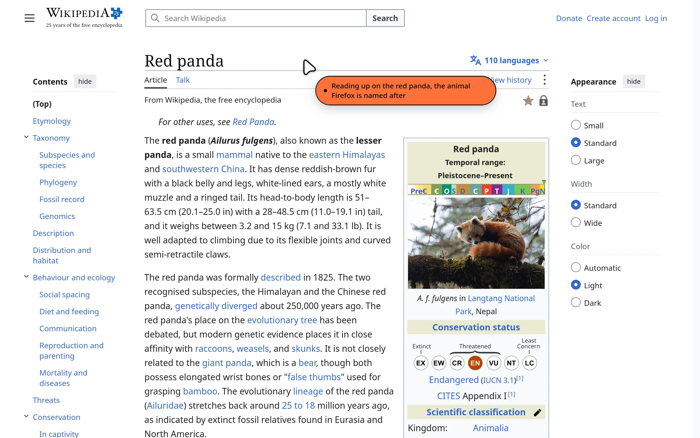

# Foxhand

Foxhand is an open-source Firefox extension and local MCP server. It lets your AI agent use the Firefox you already have open, with your tabs and logins.

[Foxhand on Firefox Add-ons](https://addons.mozilla.org/en-US/firefox/addon/foxhand/) · [Official website](https://foxhand.pages.dev/) · [What's new in 0.6.2](CHANGELOG.md)



This addon allows your harness to use your Firefox natively using MCP (Model Context Protocol). This requires the Firefox addon and a small, easy to install helper.

Formerly WebMCP Controller.

## Install

1. Get the [addon](https://foxhand.pages.dev/go/amo?from=readme).
2. Install the helper on the system running Firefox. Choose one method:
   - **Homebrew (macOS or Linux):** `brew install hamb1y/tap/foxhand-helper && foxhand-helper install`
   - **npm (Node.js 22+, macOS or Linux):** `npm install -g @foxhand/helper && foxhand-helper install`
   - **npm (Node.js 22+, Windows PowerShell):** `npm.cmd install -g @foxhand/helper; if ($LASTEXITCODE -eq 0) { foxhand-helper.cmd install }`
   - **Shell installer (macOS, Linux or WSL):** `curl -fsSL https://foxhand.pages.dev/download/sh | sh`
   - **PowerShell installer (Windows):** `irm https://foxhand.pages.dev/download/ps | iex`
3. Paste the config from the setup page into your harness.

If the add-on doesn't pick up the helper, restart Firefox. Run `foxhand-helper install` again after upgrading through Homebrew. If Firefox runs on Windows but your AI runs in WSL, install the helper on Windows and enable WSL access in Foxhand Settings.

Claude Code:

```bash
claude mcp add -s user -t http firefox http://localhost:8901/mcp -H "Authorization: Bearer <token>"
```

Everything else:

```json
{ "mcpServers": { "firefox": { "type": "http", "url": "http://localhost:8901/mcp", "headers": { "Authorization": "Bearer <token>" } } } }
```

The setup page has the config for other harnesses.

### Claude Desktop (the Claude app)

Claude may refuse when you ask it to edit its own configuration. Set up Foxhand yourself from the app's settings:

1. In Firefox, open **Foxhand → Settings → Connect your AI → Claude app**, then copy the config. This setup needs Node.js.
2. In the Claude app, open **Settings → Developer → Edit Config**. Paste the setup JSON if the file is empty. If it already has servers, add only the `firefox` entry inside its existing `mcpServers` object.
3. Save `claude_desktop_config.json`. Fully quit and reopen Claude, keep Firefox open with Foxhand showing **Ready**, then ask Claude to list your Firefox tabs.

Don't paste the config into the chat: it contains your local bearer token. This is for the desktop app, not claude.ai in a browser.

Check it works:

```bash
curl http://localhost:8901/health
# {"ok":true,"extensionConnected":true,"version":"0.6.2"}
```

## Tools

Tabs and windows (12)
`tab_query` `tab_check_active` `tab_create` `tab_navigate` `tab_focus` `tab_close` `tab_pin` `tab_mute` `window_query` `window_create` `window_focus` `window_close`

Reading pages (6)
`page_snapshot` `page_text` `page_html` `page_screenshot` `page_info` `page_find`

Acting on pages (10)
`page_click` `page_type` `page_fill` `page_select` `page_hover` `page_scroll` `page_key` `page_wait` `page_drag` `page_upload`

Browser data (14)
`bookmark_query` `bookmark_create` `bookmark_remove` `history_query` `download_query` `download_start` `cookie_query` `cookie_set` `cookie_remove` `storage_get` `storage_set` `storage_remove` `session_query` `session_restore`

Meta (3)
`extension_status` `thought` `event_wait`

## Safety

Pause the AI with Ctrl+Shift+. or the popup.
The helper only listens on localhost and needs your token.
Websites can try to instruct your agent. Be careful where you send it.

[Privacy](https://foxhand.pages.dev/privacy)

## Problems

Run the helper install again. If that doesn't fix it, [open an issue](https://foxhand.pages.dev/go/issue?from=readme).

## Build

Needs Node.js 22.

```bash
git clone https://github.com/hamb1y/foxhand.git
cd foxhand
git checkout v0.6.2
npm ci
npm run build
npm test
bash scripts/pack-extension.sh
```

## Star History

<a href="https://www.star-history.com/?repos=hamb1y%2Ffoxhand&type=date&legend=top-left">
 <picture>
   <source media="(prefers-color-scheme: dark)" srcset="https://api.star-history.com/chart?repos=hamb1y/foxhand&type=date&theme=dark&legend=top-left" />
   
 </picture>
</a>

## License

[MPL-2.0](LICENSE). Cursors are [Bibata](https://github.com/ful1e5/Bibata_Cursor) (GPL-3.0).
