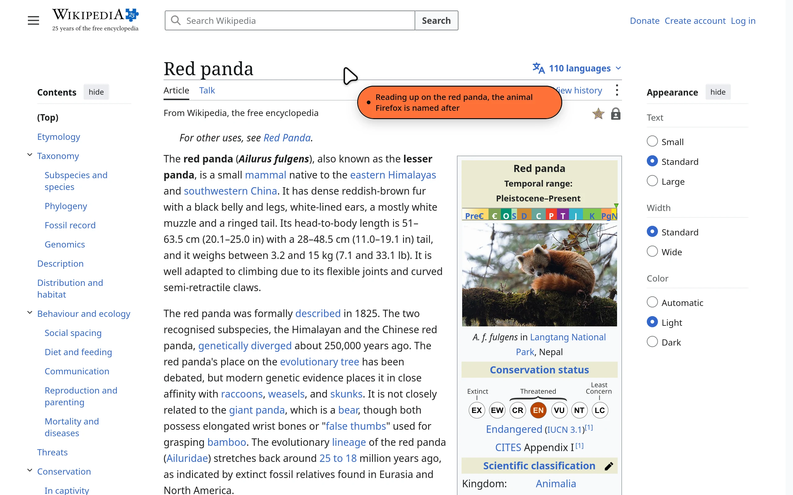

# Foxhand

Let an AI agent drive the Firefox you already use: your current profile, your
open tabs, your logins. Any MCP client can connect, including Claude Code,
Codex, Gemini CLI, opencode and Cursor.

*Formerly WebMCP Controller. Renamed so it isn't confused with
[WebMCP](https://webmachinelearning.github.io/webmcp/), the proposed standard
for websites to expose their own tools to agents. Upgrading? See
[Moving from WebMCP Controller](#moving-from-webmcp-controller).*

There is no server to start by hand. Firefox launches a small helper app (a
native messaging host) when the add-on loads, and the helper serves MCP on
your own machine.

[**Install the add-on from addons.mozilla.org**](https://addons.mozilla.org/en-US/firefox/addon/webmcp-controller/)
· [Website](https://hamb1y.github.io/foxhand/)
· [What's new in 0.5.2](CHANGELOG.md)



*A real capture: an MCP client asked Foxhand to search Wikipedia, then point at
the article. The orange bubble is the AI saying what it's doing.*

## Features

- **Your real browser.** Works on your current profile, with your tabs,
  bookmarks, history and logged-in sessions. Not a clean headless browser.
- **Local by design.** The helper listens on this computer only (`localhost`) and every request
  needs a 256-bit bearer token. Nothing leaves your machine unless the AI tool
  you connect sends it somewhere.
- **Visible AI cursor.** While the agent works, a cursor glides to whatever it
  is clicking or typing into, with an orange bubble that says what it is
  doing. Toggle it from the popup.
- **Pause AI.** The popup button, or <kbd>Ctrl</kbd>+<kbd>Shift</kbd>+<kbd>.</kbd>,
  stops every command until you resume. The toolbar badge shows `II` while
  paused and an orange dot while the AI is working.
- **45 tools.** Tabs, windows, page reading, screenshots, typing, clicking,
  dragging, uploads, bookmarks, history, downloads, cookies and a persistent
  notebook for the agent.
  See [Tools](#tools).
- **Built for real pages.** Page dialogs (`alert`, `confirm`) never freeze an
  action, links that open a tab report the new tab, same-origin iframes are
  readable, and snapshots wait for pages that render after loading.
- **Guided setup in your language.** A setup page opens on install. The add-on
  speaks English, Spanish, French, German and Simplified Chinese.

## Quick start

1. **Install the add-on** from the link above. A setup page opens.
2. **Install the helper** (once per computer), by pasting one line:
   - macOS and Linux, in Terminal: `curl -fsSL https://hamb1y.github.io/foxhand/sh | sh`
   - Windows, in PowerShell: `irm https://hamb1y.github.io/foxhand/ps | iex`

   See [Installing the helper](#installing-the-helper).
3. **Connect your AI.** The setup page (or the toolbar popup's **Copy MCP
   config**) gives you the exact command or config. It ticks that step off when your
   AI sends its first command.

Claude Code, for example:

```bash
claude mcp add -s user -t http firefox http://localhost:8901/mcp -H "Authorization: Bearer <token>"
```

The settings page (toolbar icon → **Settings**) also has commands and snippets
for the other clients. The generic config looks like this:

```json
{
  "mcpServers": {
    "firefox": {
      "type": "http",
      "url": "http://localhost:8901/mcp",
      "headers": { "Authorization": "Bearer <token>" }
    }
  }
}
```

<details>
<summary>Other clients</summary>

- **Codex** (`~/.codex/config.toml`):
  ```toml
  [mcp_servers.firefox]
  url = "http://localhost:8901/mcp"
  http_headers = { Authorization = "Bearer <token>" }
  ```
- **Gemini CLI:** `gemini mcp add --scope user --transport http firefox http://localhost:8901/mcp --header "Authorization: Bearer <token>"`
- **opencode:** `{"mcp":{"firefox":{"type":"remote","url":"http://localhost:8901/mcp","headers":{"Authorization":"Bearer <token>"}}}}`
- **stdio-only clients:** `npx -y mcp-remote http://localhost:8901/mcp --header "Authorization: Bearer <token>"`

</details>

Check the connection from a shell:

```bash
curl http://localhost:8901/health
# {"ok":true,"extensionConnected":true,"version":"0.5.2"}
```

## Architecture

```text
 Firefox (WebExtension)                 Helper (native messaging host)          AI client
+----------------------+   stdio     +-----------------------------+   HTTP   +--------------+
| background.js       | <---------> | foxhand-host                | <-----> | Claude Code,  |
| content scripts     |  Firefox    | serves MCP on localhost     |  POST   | Codex, ...    |
| (tabs, page, cursor)|  starts it  | Bearer-token authenticated  |  /mcp   |              |
+----------------------+            +-----------------------------+         +--------------+
```

- The add-on owns the settings. It generates the **token** on first run and
  sends `{token, port, bind}` to the helper. Defaults: port **8901**, bind
  **127.0.0.1** (the helper also listens on `[::1]`, so `localhost` works
  whichever address a client tries first).
- AI clients talk to the helper over MCP Streamable HTTP, `POST /mcp`, with
  `Authorization: Bearer <token>`. Two endpoints need no token: `GET /health`
  and `GET /`.
- The helper runs as long as the add-on runs. Close Firefox and the MCP
  endpoint goes away.

Why an extension: a WebExtension gets every tab, window, bookmark and cookie
of the profile you use, which the remote-debugging protocol does not offer.
Why a native host: extensions cannot listen on ports, and native messaging is
the sanctioned way for an add-on to reach a local program.

## Installing the helper

**Windows**, in PowerShell:

```powershell
irm https://hamb1y.github.io/foxhand/ps | iex
```

(In Command Prompt, type `powershell` first.)

**macOS, Linux, WSL**, in a terminal (inside WSL it installs the Windows helper):

```sh
curl -fsSL https://hamb1y.github.io/foxhand/sh | sh
```

The script picks the x64 or arm64 binary, checks its SHA-256 against the
release's `SHA256SUMS` and runs `install`. On macOS there's no Gatekeeper
prompt: the binary carries an ad-hoc signature, and the script re-signs it if
that doesn't verify. These are the same scripts as `install.sh` and
`install.ps1` in each release, served from this repo's GitHub Pages.

Prefer to do it by hand? Download `foxhand-host-<os>-<arch>` from the
[releases page](https://github.com/hamb1y/foxhand/releases/latest), then run it
with `install`: on Windows, double-click the `.exe`; on macOS, run
`xattr -c foxhand-host-darwin-arm64` first, because a browser download is
quarantined.

`install` copies the helper to a per-user folder and registers it with Firefox.
No admin rights needed.

| OS | Helper goes to | Registered via |
|---|---|---|
| Windows | `%LOCALAPPDATA%\foxhand\` | `HKCU\Software\Mozilla\NativeMessagingHosts\webmcp_controller` |
| macOS | `~/Library/Application Support/foxhand/` | `~/Library/Application Support/Mozilla/NativeMessagingHosts/` |
| Linux | `~/.local/share/foxhand/` | `~/.mozilla/native-messaging-hosts/` (and the Snap path) |

Other commands: `status`, `uninstall`, `version`, `help`.

**To update**, run the install command again. Firefox switches to the new
helper within a few seconds, with no restart.

### Moving from WebMCP Controller

Foxhand is the same add-on under a new name: AMO updates it in place and your
settings and token stay. Run the install command once more. It installs
`foxhand-host`, makes the running WebMCP Controller helper hand over to it, and
the old `webmcp-controller` folder is removed shortly after. Your AI's MCP
config keeps working; re-copying it gives you the shorter `localhost` URL.

### Running from a source checkout

```bash
npm install
npm run install-host   # registers a Node-based helper with Firefox
```

Then load `extension/manifest.json` as a temporary add-on at
`about:debugging#/runtime/this-firefox` → **Load Temporary Add-on…**.

## Harness inside WSL, Firefox on Windows

WSL2's default NAT networking cannot reach Windows' `127.0.0.1`. The easy path:

1. Toolbar icon → **Settings** → **Connect your AI**. Pick your AI, then set
   **Runs in** to **WSL**. This allows AIs in WSL to connect.
2. If Windows Firewall asks about `foxhand-host`, allow it on **Private networks**.
3. Copy the config and paste it inside WSL. The Claude Code and Gemini commands
   look up the Windows address on each run, so they survive reboots. Config
   files hold the current address, so copy them again if the connection drops
   after a Windows restart.

The helper then listens on the `vEthernet (WSL)` adapter only, not your LAN.
Alternatively, enable WSL mirrored networking (`networkingMode=mirrored` under
`[wsl2]` in `%UserProfile%\.wslconfig`, then `wsl --shutdown`). After that,
`127.0.0.1:8901` works from WSL as-is.

## AI cursor

While the agent works, an animated cursor on the page glides to what it is
clicking or typing into. A bubble beside it says what it is doing.

- **Actions** (`page_click`, `page_type`, ...): the cursor moves to the target,
  then clicks with a ripple. The bubble describes the action, such as "Clicking
  “Sign in”", in the browser's language. Typed passwords are never echoed.
- **`thought`:** the agent can explain its reasoning, for example `"Opening
  the pricing page to compare plans"`. The note shows right away and stays on
  the next page action (read or act) within 30 seconds, then the cursor goes
  back to describing actions itself.
- The cursor is drawn in a closed shadow root with `pointer-events: none`. It
  never blocks real input or appears in `page_html` or `page_snapshot`, and it
  is hidden while `page_screenshot` captures.
- It fades after 8 seconds idle. Turn it off in the popup (**Show AI cursor**)
  or in Settings (**Show the AI cursor**). It is on by default.

Cursor shapes are [Bibata](https://github.com/ful1e5/Bibata_Cursor) by ful1e5
(GPL-3.0).

## Tools

Tool names match `registerTool(` in `mcp-server/src/tools/*.ts`. They follow
`<thing>_<verb>`: `tab_query`, `page_click`, `cookie_set`.

Page tools find an element by `ref` (from `page_snapshot`), by `name` (its
visible text or label, with optional `role` and `nth`), by CSS `selector`, or
by `x`,`y` viewport coordinates for canvas apps. When a name matches several
elements, the `AMBIGUOUS` error lists them.

<details>
<summary><strong>Tabs and windows</strong> (12)</summary>

| Tool | What it does |
|---|---|
| `tab_query` | List tabs (`query: "*"` or nothing) or find them by text in the URL or title, URL/title regex and state flags. |
| `tab_check_active` | The tab the user is looking at (id, url, title, window). |
| `tab_create` | Open a tab. Adds `https://` when the scheme is missing (`http://` for `localhost` and IP addresses). `duplicateOf` copies an existing tab. |
| `tab_navigate` | Load a URL, or `go: "back"`, `"forward"` or `"reload"`. |
| `tab_focus` | Switch to a tab and bring its window forward. |
| `tab_close` | Close one tab (`tabId`), several (`tabIds`) or the active one. Needs `confirm:true`. |
| `tab_pin` | Pin a tab, or unpin it with `pinned:false`. |
| `tab_mute` | Mute a tab, or unmute it with `muted:false`. |
| `window_query` | List windows (id, focused, private, tab count). |
| `window_create` | Open a new window, optionally at a URL. |
| `window_focus` | Bring a window to the front. |
| `window_close` | Close a window and its tabs. Needs `confirm:true`. |

</details>

<details>
<summary><strong>Reading pages</strong> (6)</summary>

| Tool | What it does |
|---|---|
| `page_snapshot` | Outline of the page with `[ref=N]` for each element. Includes shadow DOM and same-origin iframes, waits for pages still rendering. `within` reads one region, `viewportOnly` just what's on screen. |
| `page_text` | Visible text, in chunks for long pages (`offset`, `nextOffset`), optionally `within` one region. |
| `page_html` | HTML of the page or of one part (`selector` or `within`). |
| `page_screenshot` | The visible area, one element, or the whole page (`fullPage`). `format: "jpeg"` and `scale` make it smaller. |
| `page_info` | URL, title and load state. |
| `page_find` | Find text, with a snippet, the ref to click and whether it's off screen. |

</details>

<details>
<summary><strong>Acting on pages</strong> (10)</summary>

| Tool | What it does |
|---|---|
| `page_click` | Click an element or a point. Reports what changed, tabs the click opened (`openedTabs`) and the new URL. |
| `page_type` | Type into a field (named by its label or placeholder), textarea or rich editor. Also sets checkboxes and selects. Can submit through the form's button, a composer's Send button, or Enter. |
| `page_fill` | Fill several fields in one call. Every field is checked first, so one bad field changes nothing. |
| `page_select` | Choose options in a `<select>` or a custom combobox or listbox. A miss lists the options. |
| `page_hover` | Send hover events for JS menus and tooltips. CSS `:hover` cannot be triggered. |
| `page_scroll` | Scroll the page, an element into view, or inside a scroller. Finds the inner scroller of chat apps. |
| `page_key` | Press a key with modifiers. Performs the default action (Tab, Enter, Space, editing keys) when the page doesn't. |
| `page_wait` | Wait for text or an element to appear, for it to go (`gone:true`, for spinners), or for the page to settle. |
| `page_drag` | Drag an element or point onto another: sortable lists, sliders, map panning. |
| `page_upload` | Attach files to a file input or drop zone. The agent supplies the contents; files on disk can't be read. |

Page dialogs never block an action. While the AI acts, `alert()` is
acknowledged and `confirm()`/`prompt()` are answered **Cancel**; the result
lists what the page asked (`dialogs`). To answer OK, repeat the action with
`dialog: "accept"` (and `promptText` for a prompt).

</details>

<details>
<summary><strong>Browser data</strong> (14)</summary>

| Tool | What it does |
|---|---|
| `bookmark_query` | Find bookmarks by title or URL. |
| `bookmark_create` | Create a bookmark or folder. |
| `bookmark_remove` | Delete a bookmark by id. Needs `confirm:true`. |
| `history_query` | Search browsing history (all of it unless `startTime` is given). |
| `download_query` | List downloads with the file's path on disk, state, size, progress and why one failed. |
| `download_start` | Download a URL into the downloads folder with the browser's cookies, wait for it and return the path. |
| `cookie_query` | Cookies a page sees, from its container or private store, including partitioned ones. |
| `cookie_set` | Create or overwrite a cookie. |
| `cookie_remove` | Delete a cookie by name. Needs `confirm:true`. |
| `storage_get` | Read a key, or list keys. |
| `storage_set` | Save a value. |
| `storage_remove` | Delete a key. |
| `session_query` | Recently closed tabs and windows. |
| `session_restore` | Reopen a recently closed tab or window. |

The `storage_*` tools default to the agent's own notebook (`area: "agent"`):
JSON values kept in the add-on's storage across pages and Firefox restarts, up
to 1000 keys. `area: "local"` and `"session"` read and write the page's own
`localStorage` and `sessionStorage`.

</details>

<details>
<summary><strong>Meta</strong> (3)</summary>

| Tool | What it does |
|---|---|
| `extension_status` | Whether the add-on is connected, plus profile details. |
| `thought` | Show a note in the AI cursor bubble. It stays on the next page action. |
| `event_wait` | Wait for an event such as `tab.updated`, `tab.removed`, `tab.activated` or `download.done`. Pass the result's `seq` as `afterSeq` to catch events between calls. |

</details>

## Limits and safety

- **Local only by default.** The helper binds `127.0.0.1`. Every MCP request
  needs the 256-bit bearer token, compared in constant time. Rotate the token
  in Settings (**New**) and re-copy the config.
- **Browser checks.** Requests with a foreign `Host` or `Origin` header get a
  403, which blocks DNS rebinding and cross-site requests. The token is checked
  before the body is read.
- **Cancellation.** Closing the HTTP request, or sending
  `notifications/cancelled`, stops the command in Firefox too.
- **Confirm guard.** `tab_close`, `window_close`, `bookmark_remove` and
  `cookie_remove` refuse to run without `confirm:true`.
- **No password access.** No tool reads saved logins or the Firefox password
  manager.
- **No browser chrome in screenshots.** `page_screenshot` captures page content
  only, not the toolbar or other browser UI.
- **Prompt injection is real.** A web page can try to instruct the agent.
  Don't point it at anything you wouldn't let a stranger click through.

## Troubleshooting

- **"Helper app not installed."** The install step didn't run, or it registered
  somewhere this Firefox doesn't read. Run `foxhand-host status` to see where it
  registered, then press **Retry** in the popup.
  - Snap Firefox on Ubuntu reads `~/snap/firefox/common/.mozilla/native-messaging-hosts`.
    The installer writes there too.
  - Flatpak Firefox can't run native helpers without extra sandbox overrides.
    Use the deb or tarball build instead. The installer warns when it finds one.
- **"Helper is too old" or "add-on is too old."** Run the install command again,
  or update the add-on, as the popup says.
- **Worked before 0.3.4, "not installed" now.** Everything was renamed from
  `firefox-mcp`. Install the new add-on and run the install command once. The
  installer removes the old registration. Delete the old `firefox-mcp` folder
  after closing Firefox.
- **A PDF tab says it can't be read.** Firefox's PDF viewer doesn't let add-ons
  in. Use `page_screenshot`, or open the PDF in another app.
- **"Port 8901 is already in use."** Another app, or this add-on in a second
  Firefox profile, holds the port. In Settings, choose another port, save, then
  re-copy the MCP config.
- **401 Unauthorized.** The token changed. Re-copy the config.
- **Temporary add-on disappeared after a restart.** Temporary add-ons unload
  when Firefox closes. Reload it from `about:debugging`, or install the signed
  add-on.
- **`RESTRICTED_PAGE`.** Page-content tools (`page_*`)
  don't run on `about:`, `chrome:`, `resource:`, `moz-extension:`,
  `view-source:`, `jar:`, `data:` or `blob:` pages, or on
  `addons.mozilla.org`, or in PDFs. Firefox doesn't allow scripting there.
- **`REF_STALE` or `REF_NOT_FOUND`.** Refs from `page_snapshot` belong to one
  page load. Pass the snapshot's `generation` with the refs. After the page
  changes or navigates, take a new snapshot.
- **`PAYLOAD_TOO_LARGE`.** Firefox limits native messages to 1 MB. Ask for less
  text per call.
- **Helper logs.** The helper writes to stderr, which Firefox shows in the
  Browser Console (Ctrl+Shift+J) with a `[foxhand]` prefix, and to
  `foxhand-host.log` next to the helper.

## Development

```bash
npm install
npm run build && npm run typecheck
npm test                                 # everything below
node test/e2e.mjs                        # real background.js (mocked browser APIs) and real helper over native messaging and HTTP
MISSING=1 node test/e2e.mjs              # the "helper not installed" flow
node test/host.mjs                       # helper: reconfiguration, Host/Origin checks, size limits, cancellation, protocol mismatch
npx playwright install firefox && node test/content.mjs   # content scripts in real Firefox
node test/e2e.mjs dist/host/foxhand-host-linux-x64        # same, against a compiled helper
node test/live.mjs                       # real Firefox + this add-on + the helper, all 45 tools over MCP
node test/live.mjs --real                # ... plus a few real websites
node scripts/i18n.mjs --check            # every translation complete and generated
npx web-ext@8 lint -s extension
node scripts/site-shots.mjs              # retake the website's screenshots (site/shots/) from a real run
```

`test/live.mjs` starts your installed Firefox with a throwaway profile and a
throwaway home folder (your own profile and helper are untouched), installs the
add-on over WebDriver BiDi, and drives it through a real MCP client: fixtures
for forms, chat boxes, dialogs, iframes, shadow DOM, new tabs, sleeping tabs,
pausing, cancellation and helper crashes. CI runs it on Linux, macOS (Apple
silicon and Intel) and Windows (x64 and ARM) against the helper installed by
the one-line installers (`.github/workflows/platforms.yml`).

**Translations.** `i18n/<locale>.json` holds each language's strings
(`$1` for values). `node scripts/i18n.mjs` writes `extension/_locales`;
the generated files are committed, so the add-on still has no build step.
Messages meant for the AI stay in English.

The add-on and helper share one version number (`package.json`,
`manifest.json`, `shared/src/version.ts`). A separate wire `PROTOCOL` number
changes only on breaking bridge changes. On connect the two sides exchange both
numbers. A version mismatch gets a warning and keeps working. A protocol
mismatch tells you which side needs updating.

### Releasing

Add a `## X.Y.Z` section to [CHANGELOG.md](CHANGELOG.md) first: it becomes the
release notes, and a release without one stops before building.

```bash
node scripts/set-version.mjs X.Y.Z   # bumps every version file
git commit -am "vX.Y.Z" && git tag vX.Y.Z && git push --follow-tags
```

Pushing a `v*` tag runs `.github/workflows/release.yml`. It installs and
drives the helper on every platform first, checks that the versions match the
tag, runs the test suite, builds the helper binaries with Bun, and publishes
them with the installers, `SHA256SUMS` and the add-on zip as a GitHub release
(plus copies under the old `webmcp-host-*` names for older add-ons). Then it
submits the same add-on zip to addons.mozilla.org as a new listed version,
with the changelog section as its release notes, and AMO publishes it once
review passes. That step needs the repo secrets `AMO_JWT_ISSUER` and
`AMO_JWT_SECRET` ([AMO API keys](https://addons.mozilla.org/developers/addon/api/key/)).
`npm run release` does the GitHub part locally and needs Bun and an
authenticated `gh`; `AMO_CHANNEL=listed bash scripts/amo-sign.sh` does the AMO
part. The installers always fetch `releases/latest`, so the
published installers pick up each new release automatically.

Single-file helper binaries are built with `bun build --compile`. They aren't
signed with a developer certificate: macOS builds carry an ad-hoc signature,
which is all Apple silicon needs, and the installers never trigger Gatekeeper.
A Windows `.exe` downloaded in a browser may get a SmartScreen warning.

Add-on packaging: `bash scripts/pack-extension.sh` writes
`foxhand.zip`, with `manifest.json` at the root. Upload it at
[addons.mozilla.org/developers](https://addons.mozilla.org/developers/).
`scripts/amo-sign.sh` submits it with the AMO API from the command line
(unlisted by default, for a signed `.xpi`).

## Building from source

The add-on has no build step. The JavaScript, CSS and HTML in `extension/` ship
unmodified: nothing is transpiled, bundled or minified. Packaging copies those
files into a zip.

**Requirements**

- Linux, macOS, or Windows with Git Bash or WSL
- `bash` and `python3` 3.8 or newer (standard library only)
- `unzip` is optional; the script lists the zip contents without it

**Steps** (tested with Python 3.14 on Linux)

```bash
git clone https://github.com/hamb1y/foxhand.git
cd foxhand
git checkout v0.5.2
bash scripts/pack-extension.sh      # writes foxhand.zip
```

The zip contains the 27 files listed in `scripts/pack-extension.sh`, with
`manifest.json` at its root.

**Third-party assets.** The Google Sans Flex font (`extension/fonts/`, SIL OFL
1.1) and the Bibata cursor license (`extension/cursors/bibata/`, GPL-3.0) ship
with their license texts.

**The native helper** is a separate program that isn't part of the add-on zip.
To build it too, install Node.js 22 (the version CI uses) and, for the
single-file binaries, Bun. Then run:

```bash
npm ci                 # uses the lockfile
npm run build          # compiles shared/ and mcp-server/ with tsc
npm run build:host     # optional: single-file binaries in dist/host/ (needs Bun)
```

## License

[Mozilla Public License 2.0](LICENSE).
